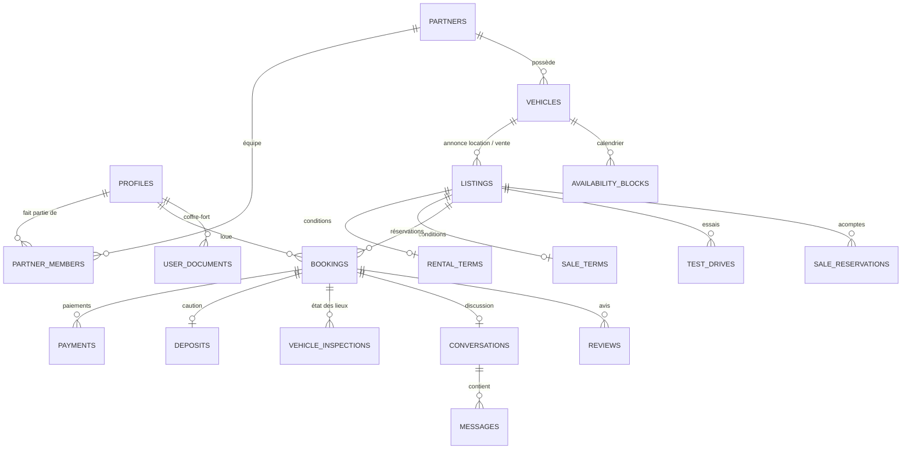

# Base de données — Plateforme de location et vente de véhicules

PostgreSQL (Supabase). 86 tables, 61 énumérations, 58 fonctions métier (RPC), 181 règles d'accès (RLS), 11 espaces de stockage.
Testée de bout en bout sur PostgreSQL 16 (34 scénarios : sécurité, location, paiement Jeko, KYC, annulation, vente, IA, stockage,
back-office, double authentification de l'équipe, factures FNE, agents IA de sécurité), dans les deux modes de droits Supabase
(projets créés avant et après mai 2026). Paiement : **Jeko**.

---

## 1. Installation

Le guide pas à pas est dans `docs/GUIDE_INSTALLATION.md` (aide-mémoire) et en ligne :
https://claude.ai/artifact/CtFUSoCoB5FHF4AQgmA73a

En bref :

```bash
npm install --save-dev supabase
cp supabase/.env.example supabase/.env
npx supabase start                        # local : migrations + seed
npx supabase link --project-ref <ID>
npx supabase db push --include-seed       # en ligne (1re fois)
npx supabase gen types typescript --local > ../../1-FRONTEND/commun/types/src/database.types.ts
```

`supabase/config.toml` règle la pile locale (Postgres 17, API sans le schéma `private`, seed automatique,
emails de connexion en français, double authentification TOTP, Google et Apple prêts à activer).

---

## 2. Choix d'architecture

- **SQL comme source de vérité** (migrations versionnées) + **types générés** par Supabase.
  Changement par rapport à l'architecture v1 (Drizzle) : Drizzle se connecte directement à Postgres et
  **contourne la RLS**. Avec `supabase-js` + session utilisateur, chaque requête passe par les règles d'accès.
- **Les prix sont calculés dans la base** (`quote_rental`, `create_rental_booking`), jamais acceptés du navigateur.
- **Pas de double réservation possible** : contrainte d'exclusion PostgreSQL sur le calendrier (`availability_blocks`), même en cas de clics simultanés.
- **Montants en FCFA entiers** (`xof` = `bigint` ≥ 0), dates en `timestamptz`, affichage `Africa/Abidjan`.
- **Identifiants en anglais**, commentaires et messages en français. Les fonctions lèvent des **codes d'erreur** stables (ex. `VEHICLE_UNAVAILABLE`) que le front traduit.

---

## 3. Carte des tables par module

| Module du cahier des charges | Tables |
|---|---|
| Référentiels | `cities`, `districts`, `vehicle_categories`, `vehicle_makes`, `vehicle_models`, `equipment`, `extras`, `insurance_plans`, `platform_settings` |
| Inscription / connexion | `profiles` (créé par trigger depuis `auth.users`), `user_roles`, `notification_preferences`, `consents`, `push_subscriptions` |
| Espace utilisateur — Vérification et docs | `user_documents` (coffre-fort), `kyc_verifications`, `account_deletion_requests` |
| Espace partenaire | `partners` (public), `partner_private` (RCCM, NCC, contacts, commission), `partner_members`, `partner_invitations`, `partner_locations` (agences / points de retrait), `partner_payout_accounts`, `partner_documents` |
| Gestion de flotte | `vehicles`, `vehicle_private` (plaque, VIN), `vehicle_equipment`, `vehicle_photos`, `vehicle_documents`, `vehicle_maintenance_logs` |
| Annonces / catalogue | `listings`, `rental_terms`, `sale_terms`, `seasonal_prices`, `listing_extras`, `favorites`, `saved_searches`, `listing_stats_daily` |
| Tunnel de réservation | `bookings`, `booking_extras`, `booking_drivers`, `booking_status_history`, `availability_blocks`, `vehicle_inspections`, `inspection_photos`, `inspection_damages`, `contracts`, `promo_codes`, `promo_redemptions` |
| Paiement et facturation | `payments`, `payment_events` (webhooks), `deposits` (caution), `refunds`, `invoices`, `invoice_counters`, `payouts`, `payout_items` |
| Cas vente | `test_drives`, `sale_reservations` (acompte), `financing_requests`, `vehicle_sales` |
| Messagerie contextuelle | `conversations` (liée à une annonce, réservation ou essai), `conversation_reads`, `messages` |
| Avis | `reviews` (deux sens : client → loueur, loueur → client) |
| Notifications | `notifications`, `notification_deliveries` (email, SMS, WhatsApp, push) |
| Confiance, sécurité, IA | `moderation_flags`, `fraud_signals`, `user_sanctions`, `blocklist`, `ai_jobs`, `ai_agent_runs`, `disputes`, `dispute_evidence`, `audit_logs` |
| Pages institutionnelles | `faq_categories`, `faq_articles`, `cms_pages`, `legal_documents`, `support_tickets`, `support_messages` |



---

## 4. Modèle de sécurité

1. **RLS activé sur les 82 tables.** Sans règle explicite, personne n'accède.
2. **Écritures retirées par défaut** aux rôles `anon` et `authenticated`, puis rendues **colonne par colonne**. Exemples :
   un client ne peut pas modifier son `kyc_status`, son `risk_score` ni se donner un rôle ;
   un partenaire ne peut pas publier lui-même une annonce, ni la certifier, ni modifier sa commission.
3. **Actions sensibles via des fonctions** `SECURITY DEFINER` (avec `search_path` figé) qui contrôlent droits et règles métier.
4. **Données sensibles séparées** : `partner_private`, `vehicle_private`, documents dans des buckets privés.
5. **Fonctions serveur uniquement** (`service_role`) : webhooks de paiement, remboursements, cron, agents IA, anonymisation.
   La clé `service_role` ne doit **jamais** se retrouver dans le navigateur (`NEXT_PUBLIC_…`).
6. **Journal d'audit** automatique (rôles, documents, KYC, annonces, réservations, paiements, cautions, remboursements, versements, sanctions, réglages).
7. **Liste noire hachée** (SHA-256) : on peut bloquer un téléphone ou un numéro de document sans le stocker en clair.

| Rôle | Peut faire |
|---|---|
| `anon` (visiteur) | Lire le catalogue publié, devis, calendrier d'occupation, FAQ, chiffres clés |
| `client` | Son profil, ses documents, réserver, payer, annuler, écrire, noter, signaler |
| `partner` (owner / manager / agent) | Sa flotte, ses annonces, ses réservations, ses KPIs ; agents : opérations, pas de prix |
| `moderator` | Valider documents, KYC, annonces, partenaires ; traiter les signalements |
| `support` | Lire réservations et tickets |
| `admin` | Tout, plus réglages, rôles et audit |

---

## 5. Fonctions métier (RPC) appelables depuis le front

Appel : `supabase.rpc('nom_fonction', { p_param: valeur })`.

**Public** : `search_listings` (plus de 25 filtres, 7 tris, distance, disponibilité sur les dates), `suggest_similar_listings`, `quote_rental`,
`get_listing_busy_periods`, `get_platform_stats`, `track_listing_event`, `search_faq`, `vote_faq`.

**Client** : `create_rental_booking`, `create_booking_payment`, `cancel_booking`, `get_booking_contacts`, `sign_inspection`,
`submit_review`, `get_my_reminders`, `start_listing_conversation`, `mark_conversation_read`, `request_test_drive`,
`update_test_drive_status`, `create_sale_reservation`, `request_account_deletion`, `cancel_account_deletion`.

**Partenaire** : `become_partner`, `invite_partner_member`, `accept_partner_invitation`, `submit_listing_for_review`,
`set_listing_status`, `respond_to_booking`, `start_booking` (scan QR), `complete_booking`, `record_vehicle_sale`,
`respond_to_review`, `get_partner_kpis` (filtres date + catégorie), `get_partner_revenue_series`, `get_partner_todos`.

**Modération** : `verify_partner`, `moderate_listing`, `review_user_document`, `decide_kyc`, `resolve_flag`, `certify_sale_listing`.

**Équipe** (second facteur obligatoire) : `staff_mfa_status` (le back-office sait s'il doit demander le code TOTP).

**Client** (ajout) : `request_privacy_action` (accès, export, rectification, opposition — loi 2013-450).

**Serveur** (`service_role`, backend Render uniquement) : `handle_jeko_payment_success` (webhook Jeko : contrôle du montant
puis validation — à utiliser à la place de `handle_payment_success`), `handle_payment_success`, `handle_payment_failure`,
`record_deposit_authorization`, `handle_refund_result`, `expire_stale_bookings`, `release_due_deposits`, `expire_sale_reservations`,
`refresh_partner_stats`, `claim_ai_jobs`, `complete_ai_job`, `claim_invoices_for_fne`, `record_fne_result`,
`find_photo_duplicates`, `anonymize_user`.

---

## 6. Agents IA : comment ils se branchent

1. Un trigger ajoute une tâche dans `ai_jobs` à chaque annonce soumise, photo, message, document, réservation ou avis.
2. Le worker du backend (Render, réveillé toutes les 5 min par `pg_cron` + `pg_net`, voir `optional/cron_render.sql`) appelle
   `claim_ai_jobs`, analyse avec le LLM, puis `complete_ai_job(verdict, score, explication)`.
3. Effets : `pass` → rien ou publication auto (risque ≤ 30 et partenaire vérifié) ; `flag` → signalement + contenu marqué ;
   `block` → contenu masqué / annonce remise en revue. **Aucune suppression, aucune validation KYC par l'IA.**
3 bis. Chaque agent est piloté dans `ai_agents` : mode `off` (interrupteur d'urgence), `shadow` (observe sans agir),
   `assist` (signale seulement), `auto` (peut masquer). Un « block » sous `block_threshold` devient un « flag » ;
   un « pass » au-dessus de `flag_threshold` devient un « flag ». Budget quotidien en dollars par agent.
   Agents de sécurité ajoutés (en `shadow` au départ) : connexions suspectes, comptes de versement, paiements, photos copiées.
4. Chaque décision est tracée dans `ai_agent_runs` (modèle, tokens, coût, hash de l'entrée — pas la donnée brute).
5. Un **pré-filtre instantané** (règles) repère déjà numéros de téléphone et demandes de paiement hors plateforme dans les messages.

---

## 7. Valeurs par défaut à valider (modifiables)

| Sujet | Choix appliqué | Où le changer |
|---|---|---|
| Assurance | RC incluse (0 FCFA) ; intermédiaire 4 000 et tous risques 9 000 FCFA/jour | `insurance_plans` |
| Frais / commission | Frais de service client 5 % ; commission 15 % sur la part loueur | `platform_settings` |
| TVA | 18 %, prix affichés TTC | `vat_rate`, `prices_include_tax` |
| Annulation | Flexible 100 % ≥ 24 h sinon 50 % · Modérée 100 % ≥ 72 h, 50 % ≥ 24 h · Stricte 50 % ≥ 7 j | `private.compute_refund_amount` |
| Frais de service remboursés | Seulement si le loueur ou la plateforme annule | idem |
| Caution | Carte : empreinte non débitée ; Mobile Money : versement puis remboursement 72 h après retour | `rental_terms.deposit_modes` |
| Délais | 30 min pour payer ; 24 h pour que le loueur réponde | `platform_settings` |
| Jours facturés | Tranches de 24 h, 1 h de tolérance au retour | `private.rental_days` |
| Remises | Durée (≥ 7 j / ≥ 28 j) ou offre du moment : la plus forte, non cumulées | `compute_rental_quote` |
| Super hôte | Note ≥ 4,8 sur ≥ 10 avis, ≥ 10 locations, réponse ≥ 90 %, aucune annulation loueur sur 90 j | `refresh_partner_stats` |
| Acompte vente expiré | Passe en `expired` ; remboursement décidé par l'équipe | `expire_sale_reservations` |
| Factures | Émises par la plateforme pour le montant total — **à valider avec un comptable** | `handle_payment_success` |
| Suppression de compte | 30 jours de délai, puis anonymisation (les traces comptables restent) | `account_deletion_requests` |
| Plafond Jeko | 2 000 000 FCFA par transaction (à confirmer par écrit) ; au-delà : `AMOUNT_ABOVE_PROVIDER_LIMIT` | `payment_provider_max_amount` |
| Compte de versement | Utilisable 72 h après son ajout ; alerte au partenaire + contrôle IA | `payout_account_cooling_hours` |
| Demandes vie privée | Réponse sous 30 jours (à confirmer avec un avocat) | `privacy_request_days` |
| Double authentification | Obligatoire pour admin, modération, support (sinon traités comme clients) | `private.staff_session_ok` |

---

## 8. Codes d'erreur (à traduire côté front)

`ACCOUNT_SUSPENDED` · `ACTIVE_BOOKINGS_EXIST` · `AUTH_REQUIRED` · `BOOKING_EXPIRED` · `BOOKING_NOT_CANCELLABLE` ·
`BOOKING_NOT_PAYABLE` · `CANNOT_BOOK_OWN_VEHICLE` · `DELIVERY_ADDRESS_REQUIRED` · `DEPOSIT_MODE_NOT_ALLOWED` ·
`DOB_LOCKED_AFTER_KYC` · `DRIVER_LICENSE_EXPIRED` · `DRIVER_LICENSE_TOO_RECENT` · `DRIVER_NOT_VERIFIED` · `DRIVER_TOO_YOUNG` ·
`DURATION_OUT_OF_RANGE` · `EXTRA_NOT_AVAILABLE` · `FORBIDDEN` · `INVALID_DATES` · `INVALID_QR_CODE` · `LICENSE_REQUIRED` ·
`LISTING_NOT_AVAILABLE` · `NOT_ENOUGH_PHOTOS` · `PICKUP_TOO_SOON` · `PROFILE_INCOMPLETE` · `PROMO_INVALID` (détail :
`PROMO_EXPIRED`, `PROMO_ALREADY_USED`…) · `RCCM_REQUIRED` · `REVIEW_ALREADY_EXISTS` · `SLOT_UNAVAILABLE` ·
`TOO_MANY_PENDING_BOOKINGS` · `VEHICLE_ALREADY_RESERVED` · `VEHICLE_UNAVAILABLE` … (liste complète : `grep "raise exception" supabase/migrations`).

---

## 9. Conformité (Côte d'Ivoire)

- Loi n° 2013-450 : déclarer le traitement à l'ARTCI avant le lancement ; la table `consents` garde la preuve horodatée des consentements.
- Vérification par selfie (biométrie) : autorisation préalable de l'ARTCI — le consentement `biometric_processing` est prévu.
- Hébergement hors du pays (région Europe) : vérifier les règles de transfert auprès de l'ARTCI.

---

## 10. Ajouts du 6 novembre 2026 (migrations `20261106…`)

| Migration | Ce qu'elle apporte |
|---|---|
| `0100_paiement_jeko` | Jeko seul prestataire ; moyens Djamo et QR PI-SPI ; plafond par transaction ; `handle_jeko_payment_success` refuse un webhook dont le montant ou la devise diffère (signal de fraude créé) |
| `0200_mfa_equipe` | Rôles admin / moderator / support reconnus seulement avec un jeton `aal2` (code TOTP validé) |
| `0300_factures_fne` | Colonnes FNE sur `invoices`, file de certification `claim_invoices_for_fne` / `record_fne_result` |
| `0400_types_agents_securite` | Nouveaux types (agents, modes, demandes vie privée, incidents) |
| `0500_agents_ia_securite` | `ai_agents` (pilotage), `security_events`, délai de carence des comptes de versement, alerte paiements répétés, empreinte des photos et `find_photo_duplicates`, `privacy_requests`, `data_incidents`, journal d'audit inviolable |

**Base déjà en ligne ?** `npx supabase db push` applique seulement ces nouvelles migrations : la première renomme
automatiquement l'ancienne valeur du prestataire en `jeko`. Les anciennes migrations ont aussi été corrigées
(texte et valeur) pour qu'une installation neuve parte directement sur Jeko.
