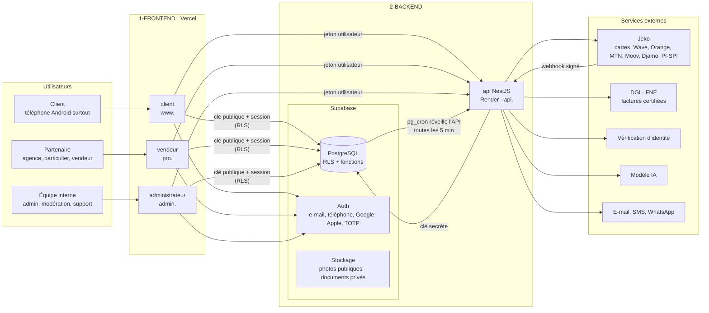
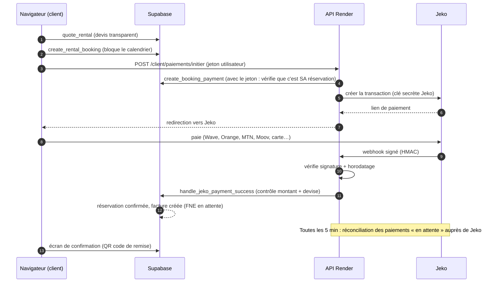
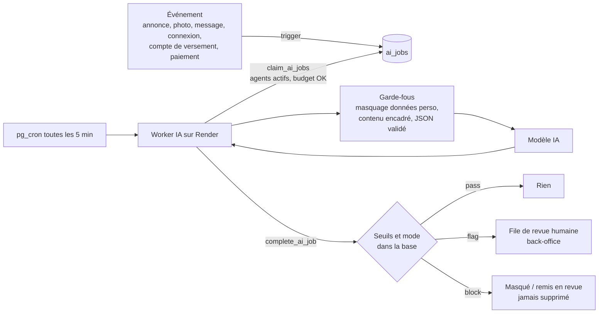

# Architecture — vue d'ensemble

*Conçue pour durer : on démarre gratuitement, on grandit sans tout réécrire.*

---

## 1. Le schéma en une image

**À retenir** : le frontend parle **directement** à Supabase pour tout ce que la RLS protège (catalogue,
réservation, messagerie, tableau de bord). Il ne passe par l'API Render que pour ce qui exige un secret
ou un service externe (payer, vérifier une identité, générer un PDF, traiter une photo).

---

## 2. Les décisions d'architecture (et pourquoi)

| # | Décision | Pourquoi | Ce qu'on a écarté |
|---|---|---|---|
| D1 | **Un seul dépôt (monorepo)** pnpm + Turborepo | Types, validation et textes partagés ; un changement de base se voit partout | Un dépôt par application (désynchronisation) |
| D2 | **Trois applications frontend séparées** (client, vendeur, administrateur) | Le site client reste léger sur mobile ; le back-office est isolé (domaine, cookies, en-têtes plus stricts, non indexé) ; déploiements indépendants | Une seule app avec des rôles (le code admin serait téléchargé par tous les visiteurs) |
| D3 | **Next.js (App Router) + TypeScript** | Rendu serveur pour le référencement Google des annonces ; PWA installable ; écosystème Vercel | Application 100 % côté navigateur (mauvais référencement) |
| D4 | **Supabase = la couche données** : PostgreSQL, Auth, Stockage, RLS, fonctions | Votre base est déjà prête et testée ; la sécurité est appliquée au plus près des données | Logique métier dans le backend (chaque appel devrait être revérifié) |
| D5 | **Backend NestJS sur Render** pour tout ce qui a un secret | Modules clairs (client / vendeur / administrateur), gardes d'authentification, injection de dépendances, testable | Fonctions serverless Vercel (Hobby : un seul cron par jour, usage non commercial) |
| D6 | **La base reste sur Supabase, pas sur Render** | La base gratuite Render expire au bout de 30 jours puis est supprimée, sans sauvegarde ; vos règles RLS et Auth sont propres à Supabase | Postgres Render |
| D7 | **Tâches de fond déclenchées par la base** (`pg_cron` + `pg_net` → API Render) | Gratuit, fiable, fonctionne malgré la mise en veille de Render | Cron Vercel (1×/jour en Hobby), worker Render (payant) |
| D8 | **Webhooks idempotents + réconciliation** des paiements | Render gratuit peut être endormi quand Jeko appelle ; la réconciliation rattrape tout paiement manqué | Se fier au seul webhook |
| D9 | **Images préparées à l'envoi** (WebP/AVIF, 3 tailles, empreinte anti-copie) par l'API | Pas de dépendance au quota d'optimisation d'images Vercel ; pages rapides en 3G/4G | Optimisation à la volée |
| D10 | **Agents IA en file d'attente, pilotables** (off / observation / assistance / auto) | Déploiement progressif, coût plafonné, aucun effet irréversible | Appels IA synchrones dans les pages |
| D11 | **Mobile : PWA d'abord, application native ensuite** (Expo / React Native) | Lancement rapide ; les paquets `commun/` (types, validation, textes) serviront à l'app native | Deux applications natives dès le départ |
| D12 | **Prestataire de paiement : Jeko** | Mobile Money + cartes + QR PI-SPI dans une seule intégration | — |

---

## 3. Qui fait quoi : Frontend / Backend / Sécurité

| Besoin | Frontend (Vercel) | Supabase (base) | API (Render) |
|---|---|---|---|
| Afficher le catalogue | ✅ page + filtres | ✅ `search_listings` (RLS : annonces publiées) | — |
| Calculer un prix | affiche | ✅ `quote_rental` (seule source de vérité) | — |
| Réserver | formulaire | ✅ `create_rental_booking` (anti double réservation) | — |
| Payer | bouton « Payer » | ✅ `create_booking_payment` | ✅ crée la session Jeko, reçoit le webhook signé |
| Vérifier l'identité | capture photo | ✅ stockage privé + statut | ✅ session du fournisseur KYC |
| Messagerie | ✅ temps réel | ✅ pré-filtre anti-contournement | ✅ agent IA (en différé) |
| Facture | télécharge | ✅ facture + file FNE | ✅ certification DGI + PDF |
| Contrat de location | télécharge | ✅ données du contrat | ✅ PDF + envoi e-mail |
| Photos d'annonce | glisser-déposer | ✅ stockage | ✅ redimensionnement, empreinte anti-copie |
| Versements aux partenaires | consulte | ✅ calcul, délai de carence | ✅ ordre de versement Jeko |
| Modération / sécurité IA | back-office | ✅ file `ai_jobs`, registre `ai_agents` | ✅ worker IA (`3-SECURITE/05-agents-ia`) |
| Notifications | centre de notifications | ✅ `notifications`, préférences | ✅ envoi e-mail / SMS / WhatsApp / push |

---

## 4. Les flux critiques

### 4.1 Réservation et paiement d'une location

**Points de sécurité** : le prix vient de la base ; le navigateur ne choisit ni le montant ni le statut ;
la page de retour Jeko n'a **aucune valeur de preuve** ; un webhook au mauvais montant crée un signal de fraude.

### 4.2 Caution

| Mode | Quand | Comment |
|---|---|---|
| `at_pickup` (par défaut au lancement) | Agences professionnelles | L'agence encaisse elle-même à la remise (son propre compte Jeko) |
| `refundable_payment` | Mobile Money | Débitée via Jeko, remboursée 72 h après le retour sans litige |
| `card_preauthorization` | Carte bancaire | Seulement si Jeko confirme par écrit la pré-autorisation |

### 4.3 Agents IA

---

## 5. Les environnements

| Environnement | Frontend | API | Base |
|---|---|---|---|
| **Local** | `pnpm dev` | `pnpm dev` | `supabase start` (Docker) |
| **Recette** (staging) | Vercel « Preview » de chaque branche | Render : service de recette (optionnel) | 2ᵉ projet Supabase gratuit |
| **Production** | Vercel « Production » (branche `main`) | Render (branche `main`) | Projet Supabase principal |

Règle : **jamais de données réelles en local ou en recette** (utiliser `seed.sql`).

---

## 6. Les domaines

| Adresse | Application | Particularités |
|---|---|---|
| `www.votre-domaine.ci` | client | Indexée par Google, PWA, pages par ville/catégorie |
| `pro.votre-domaine.ci` | vendeur | Non indexée, double authentification proposée |
| `admin.votre-domaine.ci` | administrateur | Non indexée, double authentification **obligatoire**, en-têtes stricts, session courte |
| `api.votre-domaine.ci` | API Render | CORS limité aux trois domaines ci-dessus |

Chaque application a **sa propre session** : une session client volée ne donne jamais accès au back-office.

---

## 7. Comment l'architecture grandit

| Étape | Déclencheur | Changement | Code à réécrire |
|---|---|---|---|
| Bêta privée | — | Tout gratuit | — |
| Lancement public | 1ᵉʳ paiement réel | Vercel Pro, Supabase Pro, Render Starter (voir `DEPLOIEMENT.md`) | Aucun |
| Croissance | > 1 000 réservations / mois | Instance Supabase plus grosse, 2ᵉ instance Render, cache (Redis) pour les recherches | Aucun |
| Application native | Demande des utilisateurs | Ajout `1-FRONTEND/mobile` (Expo) qui réutilise `commun/` | Aucun |
| Autres pays UEMOA | Expansion | Référentiels (villes, TVA, documents) déjà en tables | Peu |

C'est le critère « architecture qui dure » : **chaque étape de croissance est un changement de réglage
ou un ajout, jamais une réécriture.**
